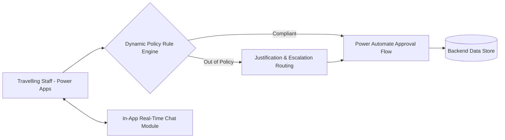
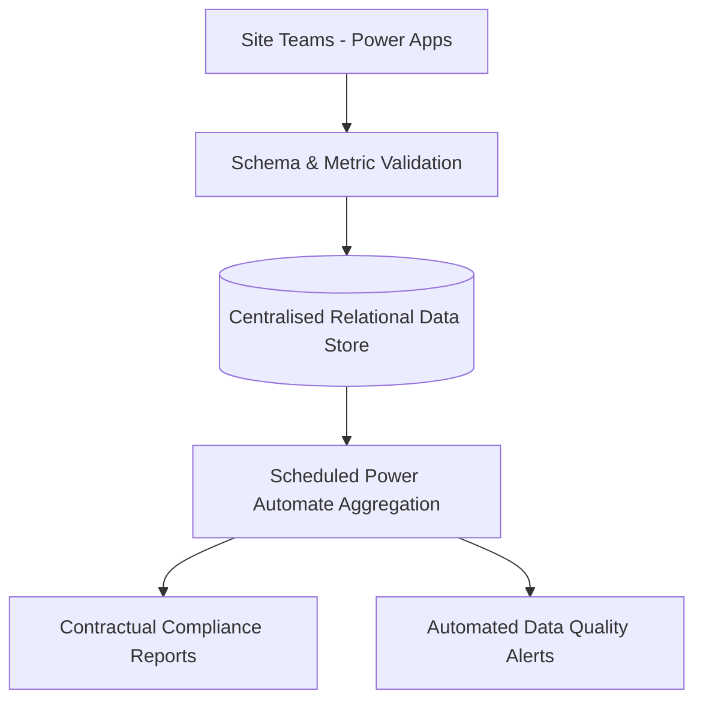
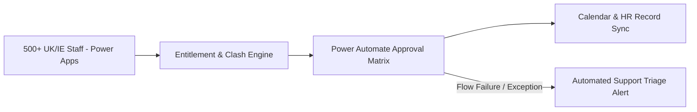

# Long Au | Power Platform & Application Support Portfolio

Welcome to my technical portfolio. I am a **Power Platform Developer** experienced in designing, deploying, and supporting business-critical Microsoft Power Platform solutions (**Power Apps, Power Automate, Power BI, Dataverse, SharePoint**) for **500+ users across UK and Irish operations**.

*🔒 **Confidentiality & GDPR Note:** Because these solutions were architected for enterprise production environments, all screenshots, schemas, and Power Fx (`.fx.yaml`) code snippets in this repository have been sanitized and anonymized.*

---

## 🚀 Featured Enterprise Projects

1. **Travel Request & Dynamic Policy Management Solution** *(Power Apps, Power Automate, Dynamic Rule Engine, In-App Chat)*
2. **Social Values & Sustainability Compliance Tracker - Transport Scotland Contract** *(Power Apps, Power Automate, Contractual Reporting)*
3. **Enterprise Staff Holiday & Leave Management System - 500+ Users** *(Power Apps, Multi-Tier Approval Matrix, Calendar Sync, Support Runbooks)*

---

## 🏗️ Project 1: Travel Request & Policy Management Solution

### Architecture & Workflow

### Key Engineering & Support Highlights
* **Dynamic Rule Engine:** Instead of hardcoding policy limits inside Power Fx formulas, travel rules (budget caps, notice periods, approval tiers) are evaluated dynamically against a configuration table—allowing admins to update company travel policies with zero code deployments.
* **In-App Chat Module:** Built an embedded messaging experience inside the app so administrators and travellers can resolve booking queries in context, eliminating lost email threads.

---

## 🌱 Project 2: Social Values Tracking Application (Transport Scotland Contract)

### Architecture & Workflow

### Key Engineering & Support Highlights
* **Contractual Alignment:** Designed strict front-end validation rules to ensure decarbonisation and community outreach data entered by site teams meet Transport Scotland audit standards.
* **Automated Aggregation:** Built scheduled Power Automate flows to consolidate multi-site metrics and flag missing or anomalous entries automatically.

---

## 📅 Project 3: Staff Holiday & Leave Management Application (500+ Users)

### Architecture & Support Workflow

### Key Engineering & Support Highlights
* **Enterprise Scale (500+ Users):** Replaced manual paper/Excel processes across UK and Irish operations with a unified digital workflow.
* **Edge-Case Handling:** Engineered logic to handle pro-rata entitlements, cross-year bookings, overlapping team absences, and out-of-office manager delegation.
* **Proactive Support & Runbooks:** Implemented `Try / Catch` Scope blocks in Power Automate to capture connector timeouts or user-lookup failures, sending instant diagnostic alerts with the Flow Run URL for rapid triage.

---

## 🛠️ Standard Support Runbook Example (Incident Triage)

As a sole in-house developer supporting 500+ users, I maintain clear runbooks to standardise incident triage and reduce recurring support overhead:

| Incident Type | Root Cause Check | Resolution Steps | Permanent Automation Fix Implemented |
| :--- | :--- | :--- | :--- |
| **Stuck Leave Approval** | Approver left company or changed department in Entra ID (Azure AD). | 1. Open Flow Run URL from error alert. 2. Verify Approver UPN in User Mapping list. 3. Re-assign approval to fallback manager. | Added pre-submission check in Power Apps using `Office365Users` connector to verify `AccountEnabled = true` before triggering flow. |
| **Policy Rule Mismatch** | User submitted travel dates across financial year boundary. | 1. Inspect request payload in backend list. 2. Check date-split formula evaluation. | Updated `OnSelect` validation formula to split multi-period travel checks automatically. |
